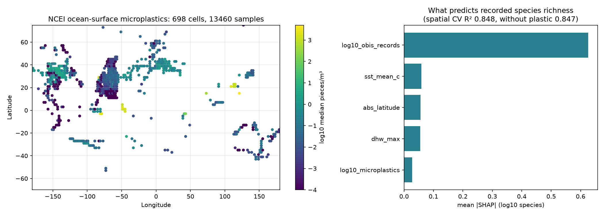

# Executive Environmental Impact Assessment: Marine Plastic Pollution on Biodiversity

**System**: MARIS (Marine AI Risk and Impact System)
**Evaluation Scope**: 40 TrashCan 1.0 test images (20 with labelled plastic, 20 without)
**Core Objective**: Detect underwater plastic waste, track fish behavioral changes, evaluate coral bleaching, integrate water quality telemetry, and forecast ecological biodiversity loss.

> **Read this first.** Real: plastic detection, Grad-CAM, fish tracking, SUIM reef segmentation, NOAA satellite SST and
> bleaching alerts. Assumed: the image-to-station assignment (TrashCan has no geotags), pH / oxygen / salinity /
> turbidity unless Copernicus is configured, and the expert formula behind the impact score and biodiversity
> loss (Section 2, item 5). Treat the scores as a demonstration of the pipeline, not as ecological findings.

---

## 1. Key Results

| Metric | Value | Reference |
|---|---|---|
| **Mean Marine Pollution Impact Score (MPIS)** | **13.2 / 100** | Tiers: Low < 25, Moderate < 50, High < 75, Critical ≥ 75 |
| **Mean Predicted Biodiversity Loss** | **10.3%** | Model output (synthetic training data) |
| **Plastic Items Detected** | **13** items; found in 9 of 20 images with labelled plastic, plus 3 false-alarm images | plastic recall 0.452 on unseen test videos |
| **Coral bleaching** | Not assessed | TrashCan frames are deep-sea (no reef); see NOAA station alerts below |
| **Mean Fish Behavioral Anomaly Index** | **18.3 / 100** | 2 of 40 images have tracked moving animals |
| **Transects at High / Critical Risk** | **0 of 40 (0.0%)** | MPIS ≥ 50 |

---

## 2. Pipeline

1. **Plastic detection & segmentation**: YOLO11-seg trained on TrashCan 1.0; coverage % from real pixel masks.
2. **Fish detection & tracking**: the same detector + ByteTrack across consecutive video frames, with ROV camera motion removed by phase correlation; speed, turning and distance to plastic per track.
3. **Coral health**: SegFormer trained on Coralscapes predicts live / bleached / dead coral directly (see Section 4); if no Coralscapes model is installed, a SUIM reef segmenter plus a colour rule for bleaching is used. Skipped for deep-sea TrashCan frames.
4. **Water quality**: Water Quality Index from temperature (NOAA CRW satellite), pH, dissolved oxygen, salinity and turbidity.
5. **Impact fusion**: XGBoost regressors predict the MPIS (0–100) and biodiversity loss % (expert-formula targets; held-out R² 0.945 for MPIS).
6. **Explainability**: SHAP TreeExplainer attributions for every transect, and Grad-CAM on the detector.
   On 6 frames with plastic detections, on average 6% of the
   Grad-CAM heat falls inside the plastic boxes (which cover only a few % of the image).

---

### Plastic detector: held-out test results

Phase 1: YOLO11-seg on TrashCan. Held-out test split (videos never used for training or model selection):

| Class | Precision | Recall | mAP50 | mAP50-95 |
|---|---|---|---|---|
| `trash_plastic` | 0.611 | 0.374 | 0.489 | 0.340 |
| `trash_metal` | 0.578 | 0.181 | 0.293 | 0.203 |
| `trash_fishing_gear` | 0.470 | 0.167 | 0.194 | 0.102 |
| `animal_fish` | 0.427 | 0.093 | 0.193 | 0.093 |
| `animal_eel` | 0.553 | 0.420 | 0.451 | 0.284 |
| `animal_crab` | 0.827 | 0.333 | 0.389 | 0.310 |
| `rov` | 0.618 | 0.664 | 0.643 | 0.471 |
| **all 16 classes (box)** | 0.507 | 0.210 | 0.252 | 0.165 |

**At the pipeline's operating threshold (conf 0.18), on the same test split:** trash_plastic precision 0.475 [0.337, 0.602], recall 0.452 [0.315, 0.594], F1 0.463 [0.340, 0.575] (95% CI, cluster bootstrap over 53 test videos, 1000 resamples). The table above uses Ultralytics' own best-F1 confidence, so its P/R differ. A threshold tuned on the validation split was also tried; validation has only 170 plastic items and it scored lower on test, so 0.18 was kept.

Plastic recall is the main limit (most plastic items are still missed), and fish recall is very low, which limits how many fish can be tracked. Confusion matrix and PR/F1 curves: `outputs/figures/`; training curves: `outputs/figures/training_curves_yolo11s_seg_v2.png`.

---

## 3. Fish Tracking

53 test videos tracked; 34 animal tracks, 8 mobile (fish/eel/crab) tracks of 3+ frames ({'eel': 5, 'fish': 2, 'crab': 1}). Median mobile speed 12.31 px/frame vs. 1.75 px/frame for near-static animals (measurement noise floor). Mobile tracks passing within 25% of the image diagonal of plastic: 3 - too few to test whether plastic changes behaviour.

## 4. Coral Reef Segmentation Model

SegFormer MiT-B2 (v2 fine-tuned) trained on Coralscapes (Red Sea reefs; 39 expert classes grouped into other / live / bleached / dead coral). Results on the official TEST split (392 images from 5 dive sites never used for training or model selection):

| Metric | Value |
|---|---|
| Coral IoU (live + bleached + dead) | **0.767** (gate 0.5) |
| Live / bleached / dead coral IoU | 0.806 / 0.694 / 0.328 |
| Mean IoU (4 groups) | 0.693 |
| Pixel accuracy | 0.943 |
| Coral vs not-coral pixel accuracy | 0.952 |
| Image level 'bleaching present?' accuracy | 0.957 (majority baseline 0.829) |

**Credit and comparison:** v2 starts from the Coralscapes authors' published SegFormer (`EPFL-ECEO/segformer-b2-finetuned-coralscapes-1024-1024`) and was fine-tuned to the 4 groups. On TEST: published (no fine-tune) coral IoU 0.768, mIoU 0.688; v2 fine-tuned coral IoU 0.767, mIoU 0.693. Fine-tuning changed TEST results very little; the gain over our own v1 (trained from ImageNet at half resolution: coral IoU 0.704) comes mainly from the authors' model and full-resolution evaluation. VAL scores (~0.94) are not reported as accuracy: the published model was most likely tuned on that split.

**Domain check on deep-sea footage:** on 200 TrashCan test frames (no reef) the model alone marked 1 of them as >=2% coral; auto mode declared coral on 0 of them.

## 5. Real-World Evidence: Microplastics vs. Recorded Biodiversity

Built only from real public data: 13460 NOAA NCEI ocean-surface microplastic samples aggregated into 698 two-degree ocean cells, OBIS species counts for each cell, and NOAA Coral Reef Watch sea temperature and heat stress. XGBoost predicts log10 recorded species richness, with OBIS sampling effort and latitude as controls, evaluated by 5-fold spatial block CV (10-degree blocks).

| Model | Held-out R² |
|---|---|
| Sampling effort only | 0.822 |
| All features except microplastics | 0.847 |
| All features incl. microplastics | **0.848** |

Adding microplastics changes held-out R² by **+0.001**. Feature importance (mean |SHAP|): `log10_obis_records` 0.626, `sst_mean_c` 0.059, `abs_latitude` 0.056, `dhw_max` 0.055, `log10_microplastics` 0.027. Correlation between microplastic level and its SHAP contribution: -0.14 (negative = more plastic associated with fewer recorded species). This is an association across ocean regions, not proof that plastic causes species loss.

## 6. Survey Stations (NOAA Coral Reef Watch, real satellite data)

| Station | SST (°C) | DHW (°C-weeks) | Bleaching alert | Images assigned | Mean MPIS |
|---|---|---|---|---|---|
| Raja Ampat, Coral Triangle | 29.05 | 0.0 | Bleaching Watch | 8 | 7.6 |
| Cairns Sector, Great Barrier Reef | 25.21 | 0.0 | No Stress | 8 | 7.0 |
| Red Sea Central Channel | 31.79 | 1.19 | Bleaching Watch | 8 | 17.0 |
| Manila Bay Outflow | 30.28 | 4.79 | Alert Level 1 | 8 | 18.1 |
| Gulf Coastal Estuary | 28.49 | 7.46 | Bleaching Watch | 8 | 16.0 |

---

## 7. SHAP Attribution Summary (computed over all 40 transects)

Most influential feature on average: **`plastic_coverage_percentage`**. SHAP values are relative to the model's
average synthetic site, so a feature "lowers" the score when these images have less of it than that
average (e.g. most images have little or no plastic).

| Feature | Mean abs. SHAP (score points) | Mean SHAP | Direction |
|---|---|---|---|
| `plastic_coverage_percentage` | 5.39 | -4.23 | lowers score on average |
| `fish_behavior_anomaly_index` | 4.24 | -4.24 | lowers score on average |
| `water_quality_index` | 3.81 | +2.03 | raises score on average |
| `plastic_count` | 2.81 | -2.81 | lowers score on average |
| `coral_bleaching_severity_index` | 1.66 | -1.66 | lowers score on average |
| `temperature_c` | 0.95 | +0.64 | raises score on average |
| `coral_cover_percentage` | 0.89 | +0.89 | raises score on average |
| `coral_present` | 0.49 | +0.49 | raises score on average |

---

## 8. Data Provenance

| Component | Status |
|---|---|
| Plastic Detection | REAL - YOLO11-seg trained on TrashCan 1.0, run on real test images |
| Plastic Detector Quality | Held-out test - trash_plastic on unseen test videos at conf 0.18: precision 0.475 [0.337, 0.602], recall 0.452 [0.315, 0.594] (95% CI over 53 videos) |
| Fish Behavior | REAL, SMALL SAMPLE - ByteTrack over test video frames with camera-motion compensation; few mobile animals are tracked, so plastic-related behaviour change cannot be concluded |
| Coral Health | TRAINED - SegFormer MiT-B2 (v2 fine-tuned) on Coralscapes; official TEST (5 unseen dive sites) coral IoU 0.767, bleached-coral IoU 0.694. Live / bleached / dead coral come from the model (expert labels), not a colour rule. Not applied to TrashCan (deep-sea, no reef). |
| Water Temperature And Bleaching Alert | REAL - NOAA Coral Reef Watch 5km daily satellite SST, Degree Heating Weeks and Bleaching Alert Area at each station |
| Ph Oxygen Salinity Turbidity | PRESET - station values (Copernicus Marine loader is implemented but needs a free account: `copernicusmarine login`) |
| Station Assignment | ASSUMED - TrashCan images have no geotags, so images are assigned to stations in rotation |
| Observational Plastic Biodiversity Model | REAL DATA, ASSOCIATION ONLY - NCEI + OBIS + NOAA CRW, 698 cells, spatial-CV R² 0.848 (microplastics gain +0.001) |
| Impact Score And Biodiversity Loss | EXPERT FORMULA - XGBoost reproduces a documented hand-specified formula (synthetic training data); weights are assumptions, see src/modules/impact_scoring.py |
| Shap | REAL - SHAP TreeExplainer on the XGBoost model (explains the model, which is trained on synthetic data) |
| Gradcam | REAL - gradient-based Grad-CAM on the YOLO neck layers for the trash_plastic logit |
| Geospatial Map | REAL station positions + NOAA CRW values; per-station scores average the images assigned to each station |

---

## 9. Standard Decision-Support Recommendations

Rule-based guidance templates, triggered by score thresholds:

1. **Debris Extraction**: prioritise cleanup where plastic coverage exceeds 5%.
2. **Thermal Stress Response**: shading and monitoring for reefs at NOAA Alert Level 1 or above.
3. **Runoff Containment**: sediment barriers where turbidity exceeds 5 NTU or oxygen is low.
4. **Zoning**: protective restrictions where MPIS exceeds 50.

---
*Generated by the MARIS assessment pipeline (`python -m src.run_assessment`).*
